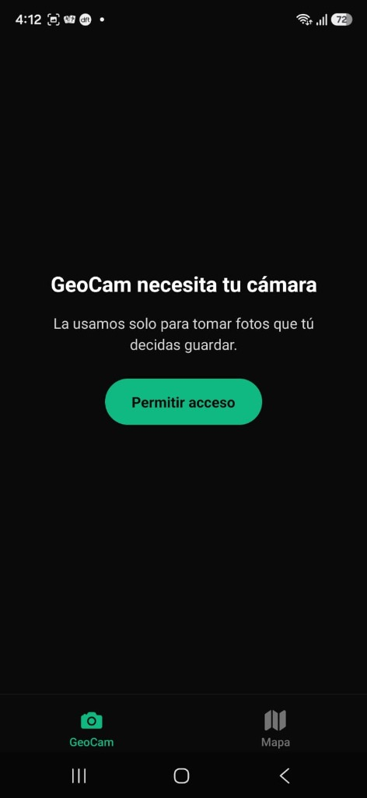
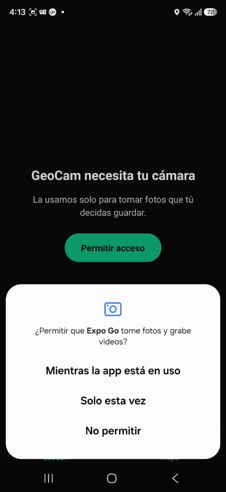
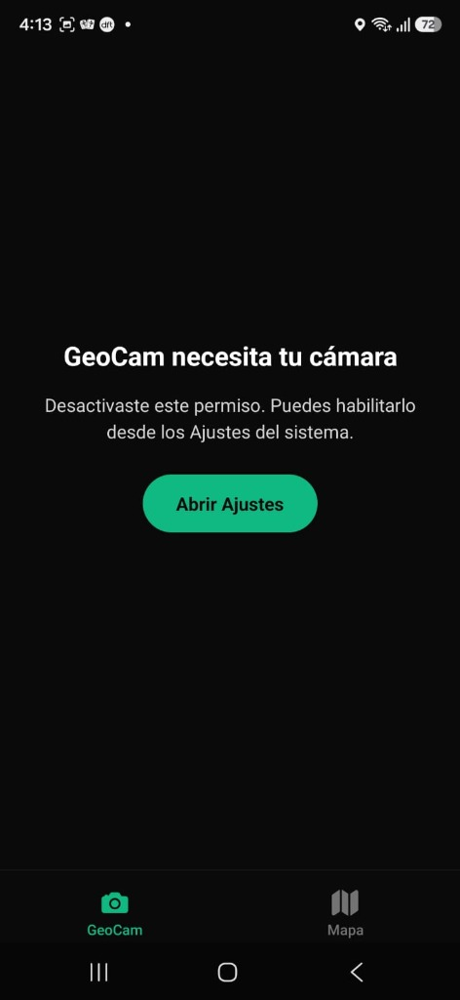
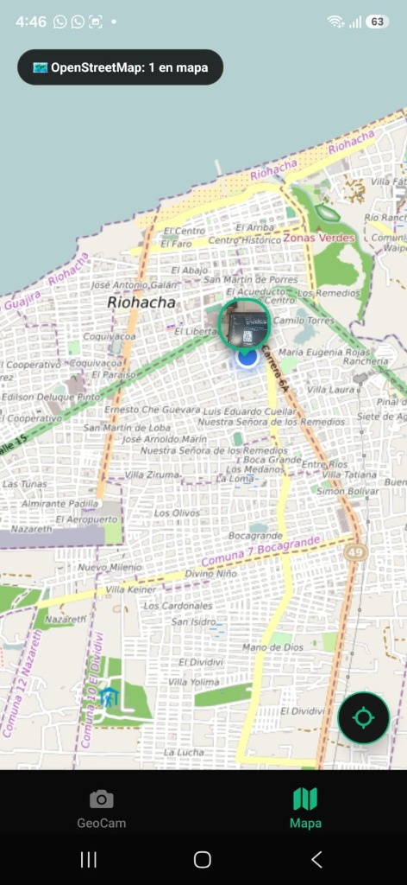

# GeoCam 📷📍

**Taller Integrador 2 – Semana 6: Módulos Nativos y Sensores del Dispositivo**  
**Desarrollado por:** Ramiro José Gómez Agámez y Álvaro Javier Pinto Sierra

GeoCam es una aplicación móvil desarrollada con **Expo SDK 57**, **Expo Router**, **React Native**, **TypeScript**, **OpenStreetMap (Leaflet)** y **Tailwind CSS (NativeWind v4)** que encapsula el hardware del dispositivo en **Custom Hooks tipados**, implementa el ciclo completo de permisos con degradación elegante, y gestiona sensores de movimiento y mapas interactivos.


## Actualización Semana 7: base de datos local offline-first

Esta semana GeoCam incorpora persistencia local para que las fotos y sus metadatos sigan disponibles al cerrar y volver a abrir la app, también sin conexión a internet.

### SQLite y esquema Drizzle

- Se agregaron **Expo SQLite**, **Drizzle ORM** y **Drizzle Kit**.
- La base local se llama `geocam.db`. El proveedor SQLite vive en `app/_layout.tsx` y ejecuta la inicialización antes de presentar las pantallas.
- SQLite se configura en modo **WAL**.
- `db/schema.ts` define la tabla `geo_photos` y sus tipos inferidos: identificador, URI local, latitud, longitud, precisión, marca de tiempo de coordenadas, origen (cámara o galería) y fecha de creación. Las coordenadas y la precisión aceptan valores nulos.

### Migraciones y configuración

- Se generó la migración inicial `drizzle/0000_fantastic_cammi.sql` a partir del esquema.
- `db/migrate.ts` aplica las migraciones de Drizzle cuando se abre la base de datos.
- `drizzle.config.ts` declara el driver Expo y las rutas del esquema y las migraciones.
- Babel y Metro incorporan los archivos SQL de migración en el bundle móvil.
- `npm run db:generate` permite generar una migración cuando cambie el esquema.

### Persistencia de fotos y operaciones

- `context/GeoPhotosContext.tsx` ahora consulta y escribe los registros mediante Drizzle; carga las fotos guardadas al iniciar.
- `db/photoStorage.ts` copia cada imagen al directorio persistente de documentos de la app. La base guarda esa URI para mantener el acceso sin red y evitar depender de rutas temporales de cámara o galería.
- Capturar con la cámara e importar desde galería crean registros locales. Si no hay ubicación disponible, la foto se conserva con coordenadas nulas.
- Eliminar una foto o borrar todas elimina sus registros y los archivos locales asociados.
- Los errores de guardado y borrado se informan en la interfaz.
- No se agregó sincronización con servidor: el almacenamiento y las consultas de esta entrega son locales.

### Archivos incorporados o actualizados

- `app/_layout.tsx`: proveedor de SQLite e inicialización.
- `context/GeoPhotosContext.tsx`: lectura, inserción y eliminación con Drizzle.
- `db/schema.ts`, `db/migrate.ts` y `db/photoStorage.ts`: esquema, migraciones y archivos persistentes.
- `drizzle/` y `drizzle.config.ts`: migración generada y configuración Drizzle Kit.
- `babel.config.js`, `metro.config.js` y `types/sql.d.ts`: soporte para importar migraciones SQL.
- `package.json` y `package-lock.json`: dependencias y comando de generación.

### Dependencias principales de la Semana 7

- `expo-sqlite` y `expo-file-system` para base de datos y almacenamiento local.
- `drizzle-orm` para consultas y esquema tipado.
- `drizzle-kit` y `babel-plugin-inline-import` para generar y empaquetar migraciones.

## Ejecutar y verificar

```bash
npm install
npx expo start
```

Comandos de verificación y migraciones:

```bash
npx expo lint
npx tsc --noEmit
npm run db:generate
```

---

## 📸 Estados de Permiso y Evidencias de Funcionamiento

La aplicación implementa el ciclo completo de permisos exigido en la guía mediante la máquina de estados:  
`checking ➔ undetermined ➔ granted / denied ➔ blocked ➔ Ajustes del Sistema`.

| Estado / Pantalla                                   | Descripción y Comportamiento en GeoCam                                                                                                                                                                                                            |                           Evidencia Real en Dispositivo                            |
| :-------------------------------------------------- | :------------------------------------------------------------------------------------------------------------------------------------------------------------------------------------------------------------------------------------------------ | :--------------------------------------------------------------------------------: |
| **1. Explicación Previa (`PermissionPrimer`)**      | **Pedir en contexto:** Antes de solicitar el permiso al sistema operativo, se muestra una pantalla de preparación que explica al usuario por qué la app requiere acceso a la cámara.                                                              |           |
| **2. Diálogo Nativo del Sistema**                   | Al pulsar el botón verde _"Permitir acceso"_, se invoca el diálogo nativo de Android en contexto (_"¿Permitir que Expo Go tome fotos y grabe videos?"_).                                                                                          |     |
| **3. Bloqueado (`blocked` / `canAskAgain: false`)** | Si el usuario desactiva el permiso o rechaza repetidamente, la app detecta que ya no se puede solicitar y cambia automáticamente el botón a **"Abrir Ajustes"**, enviando al usuario a la configuración del sistema vía `Linking.openSettings()`. |     |
| **4. Cámara y Degradación Elegante (`denied`)**     | Si el usuario niega la ubicación, la cámara sigue funcionando al 100% y toma fotos con `coords: null`. Se notifica con un banner contextual en amarillo: _"Activa la ubicación para etiquetar tus fotos"_.                                        |            |
| **5. Mapa Interactivo OpenStreetMap (**R3**)**      | Visualización 100% funcional y abierta (OpenStreetMap + Leaflet). Centrado automático, punto azul de GPS en vivo y **marcador personalizado circular con la foto real capturada** y flecha de posición.                                           |  |

---

## 📦 Estructura del Repositorio y Custom Hooks

El proyecto cumple al 100% con los entregables solicitados:

```
GeoCam/
├── hooks/
│   ├── useCamera.ts              # ✅ Hook de cámara con CameraView y ciclo useCameraPermissions
│   ├── useGeoLocation.ts         # ✅ Hook de geolocalización con watchPositionAsync y bandera cancelled
│   └── useShake.ts               # ✅ Hook de acelerómetro para detectar sacudida con cooldown
├── context/
│   └── GeoPhotosContext.tsx      # ✅ Estado global inmutable de fotos (addPhoto, removePhoto, clearAll)
├── components/
│   └── PermissionPrimer.tsx      # ✅ Pantalla explicativa previa de permisos y redirección a Ajustes
├── types/
│   └── geo.ts                    # ✅ Tipos estrictos sin 'any' (Coords, GeoPhoto, PermissionState)
├── app/
│   ├── _layout.tsx               # Root layout con SafeAreaProvider y Tailwind
│   ├── index.tsx                 # Redirección inicial a /geocam
│   └── (tabs)/
│       ├── _layout.tsx           # Pestañas inferiores con listener global useShake
│       ├── geocam.tsx            # Visor de cámara, banner contextual y nivel digital
│       └── mapa.tsx              # Mapa interactivo OpenStreetMap con marcadores y visor 'Sin ubicación'
├── assets/
│   └── screenshots/              # ✅ Capturas reales del funcionamiento en dispositivo físico Android
├── AI-LOG.md                     # ✅ Bitácora de auditoría y detección de alucinaciones de IA
└── README.md                     # ✅ Documentación del proyecto
```

---

## 🔍 Verificación de Criterios de Evaluación

- [x] **Permisos en contexto:** La cámara solo se solicita cuando el usuario interactúa para capturar, y la ubicación tiene banner explicativo. Nunca se pide todo al iniciar la app.
- [x] **Degradación elegante:** Sin permiso de ubicación, la cámara sigue funcionando normalmente y las fotos se almacenan con `coords: null`. La app lo comunica en pantalla y en la sección _"Sin ubicación"_ de la pestaña Mapa.
- [x] **Manejo de estado bloqueado:** Cuando `canAskAgain: false`, el botón cambia automáticamente a **"Abrir Ajustes"** (`Linking.openSettings()`).
- [x] **Limpieza rigurosa de suscripciones:** Todos los efectos de escucha (`Location.watchPositionAsync` y `Accelerometer.addListener`) usan la bandera `cancelled` y ejecutan `.remove()` en la función de limpieza (`cleanup`) al salir o desmontar pantallas.
- [x] **Tipado estricto sin `any`:** Todos los hooks, estados y retornos están tipados con TypeScript estricto.
- [x] **Errores expuestos a la UI:** Los fallos de hardware o GPS se guardan en el estado del hook para mostrarse en la interfaz, sin esconderse en simples `console.log`.

---

## 💡 Respuestas a las Preguntas de Repaso de la Guía

### 1. ¿Qué diferencia hay entre un permiso `denied` y uno con `canAskAgain: false`?

- **`denied`:** El usuario rechazó el permiso, pero el sistema operativo aún permite mostrarle nuevamente el diálogo nativo de autorización la próxima vez que se solicite (`canAskAgain: true`).
- **`canAskAgain: false` (`blocked`):** El usuario marcó "No volver a preguntar" o el sistema operativo agotó las oportunidades de diálogo (en iOS tras un rechazo, en Android 11+ tras dos rechazos). La app ya no puede mostrar el diálogo nativo y la única vía es enviarlo a la configuración del sistema con `Linking.openSettings()`.

### 2. ¿Por qué un `useEffect` que se suscribe a un sensor necesita función de limpieza?

Porque los sensores nativos (como el acelerómetro o el GPS) operan en hilos nativos en segundo plano. Si el componente se desmonta y no se remueve la suscripción (`subscription.remove()`), el listener queda huérfano consumiendo batería del dispositivo y generando fugas de memoria (_memory leaks_). Además, el uso de la bandera `cancelled` previene condiciones de carrera si la promesa asíncrona de suscripción se resuelve después de que el componente fue destruido.

### 3. ¿Dónde se declaran los textos que iOS muestra al pedir un permiso?

Se declaran en el archivo de configuración [`app.json`](./app.json) dentro de la sección `ios.infoPlist` o a través de los Config Plugins de Expo (`expo-camera`, `expo-location`, `expo-image-picker`), generando las claves correspondientes en el `Info.plist` nativo (ej. `NSCameraUsageDescription`, `NSLocationWhenInUseUsageDescription`, `NSPhotoLibraryUsageDescription`).

### 4. Si una librería nativa no está incluida en Expo Go, ¿qué alternativa existe?

Se debe utilizar un **Development Build** mediante `expo-dev-client` y generar una compilación a la medida usando **EAS Build** (`eas build --profile development`) o localmente con `npx expo run:android` / `npx expo run:ios` (Continuous Native Generation).

---

## 🚀 Cómo ejecutar la app

1. Instalar dependencias:

   ```bash
   npm install
   ```

2. Iniciar el servidor con Expo Go (SDK 57):

   ```bash
   npx expo start
   # o en caso de requerir túnel:
   npx expo start --tunnel
   ```

3. Escanear el código QR con la app **Expo Go** en tu dispositivo físico Android o iOS.
